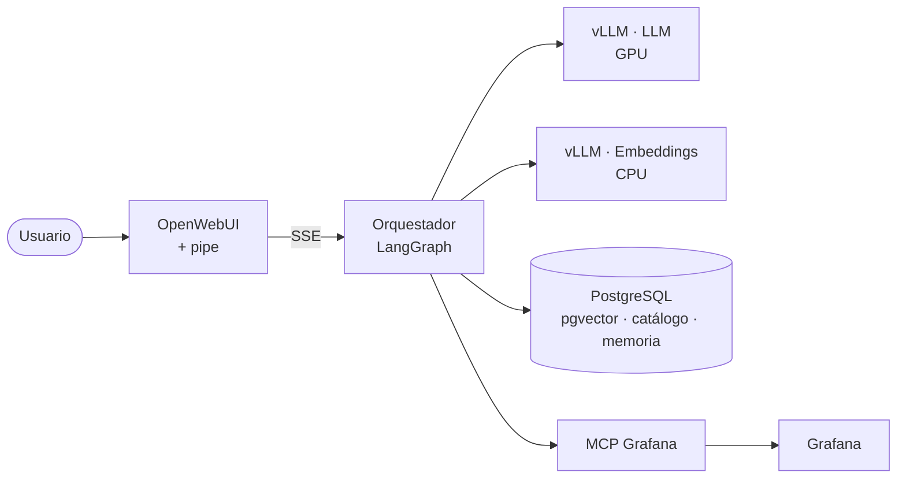
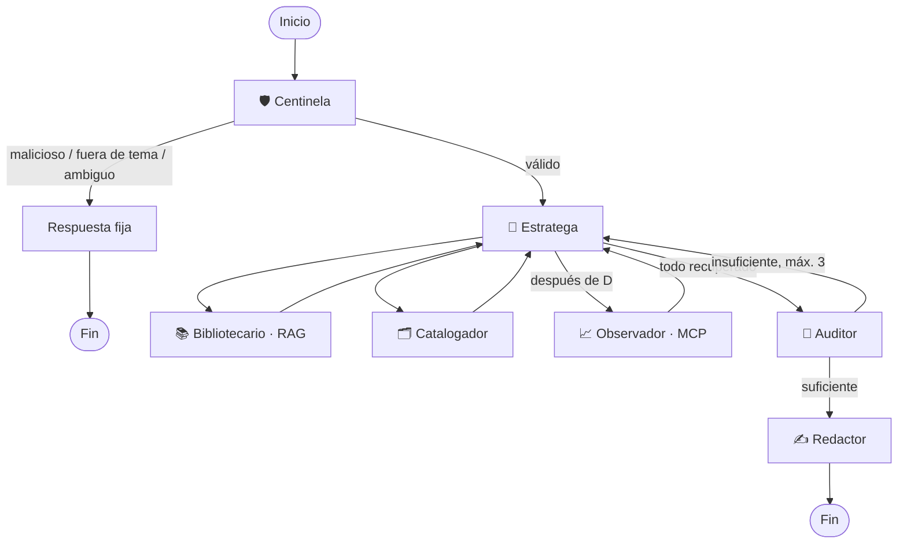

<div align="center">
 
# 🤖 Agente Payworks
**Orquestador multiagente con LangGraph para monitoreo y conocimiento de un motor de pagos**
 
<!-- TODO(ulises): GIF demo de 15–30 s (docs/assets/demo.gif) -->
<!-- TODO(ulises): diagrama principal de arquitectura (docs/assets/arquitectura.svg) -->
 
</div>
 
> **Estado:** POC en desarrollo · **Datos:** sintéticos (no contiene información real) ·
> **Propósito secundario:** servir como ejemplo educativo para construir proyectos agénticos.
 
## Resumen
El Agente Payworks responde en lenguaje natural preguntas sobre **qué es** Payworks, **qué se monitorea**
y **cómo está** en un periodo dado. Combina tres fuentes: documentación (RAG sobre pgvector),
un catálogo de paneles (PostgreSQL) y métricas en vivo (MCP server de Grafana), coordinadas por
un grafo de siete agentes especializados.
 
## 1. Problema
El equipo de monitoreo (Command) y la gerencia necesitan contexto rápido: interpretar un panel exige
conocer la aplicación, saber qué panel mirar y consultar el periodo correcto. Hoy ese conocimiento
está repartido entre personas, documentos y dashboards.
 
## 2. Solución
Un agente conversacional que encadena: **¿qué es X?** → **¿qué panel mide X?** → **¿cuánto valió X?**
Cada herramienta también funciona por separado.
 
## 3. Arquitectura

Cada componente corre en su propio pod en OpenShift. Detalle: [docs/01-arquitectura.md](docs/01-arquitectura.md).
 
## 4. Flujo agéntico

 
| Agente | Responsabilidad | LLM |
|---|---|---|
| Centinela | Filtrar, interpretar, planear (una sola vez) | Sí · JSON |
| Estratega | Instrucciones por tool, rondas, revisión técnica | Sí · JSON |
| Bibliotecario | Búsqueda vectorial con umbral | No |
| Catalogador | SQL validado sobre una tabla | Sí · SQL |
| Observador | Consulta de paneles y resumen de series | No |
| Auditor | ¿La evidencia alcanza sin inventar? | Sí · JSON |
| Redactor | Respuesta en streaming para OpenWebUI | Sí · texto |
 
> 📘 ¿Por qué así? Ver [docs/aprende/](docs/aprende/) y las decisiones en [docs/adr/](docs/adr/).
 
## 5. Despliegue
Requisitos: clúster OpenShift, `oc` con sesión iniciada y un namespace.
```bash
# 1. Recursos base (YAML en deploy/recursos/)
oc apply -f deploy/recursos/postgres/
oc apply -f deploy/recursos/vllm/
oc apply -f deploy/recursos/mcp-grafana/
oc apply -f deploy/recursos/openwebui/
 
# 2. Memoria conversacional
oc exec -i deploy/postgres -- psql -U postgres -d payworks < sql/001_memoria.sql
 
# 3. Orquestador
podman build -t quay.io/<usuario>/orquestador-payworks:0.1.0 -f Containerfile .
podman push quay.io/<usuario>/orquestador-payworks:0.1.0
cp deploy/orquestador/02-secret.example.yaml deploy/orquestador/02-secret.yaml  # completar
oc apply -f deploy/orquestador/
 
# 4. OpenWebUI: Admin Panel → Functions → importar deploy/openwebui/pipe_agente_payworks.py
```
Desarrollo local: `pip install -e . && cp .env.example .env && uvicorn orquestador.api.main:app --reload --port 8080`

Prueba de humo (sin servicios, LLM simulado): `pip install -e '.[dev]' && pytest -q tests/`
 
## 6. Resultados
<!-- TODO(ulises): latencias por nodo, ejemplos de conversación, capturas -->
_Pendiente._
 
## 7. Limitaciones conocidas
- La documentación proviene de una capacitación de 2024.
- Un solo modelo de 7B para todos los agentes (POC).
- Solo métricas por panel en un dashboard; sin logs ni PromQL libre.
 
## 8. Trabajo futuro
Modelos especializados por agente · memoria por usuario · registro de auditoría ·
observabilidad autohospedada · carga dinámica de skills.
 
## Estructura del repositorio
```
src/orquestador/   api · graph (state, nodes, builder) · tools · memory · llm · prompts · skills
deploy/            orquestador · recursos · openwebui (pipe)
docs/              visión · arquitectura · adr · aprende · PENDIENTES
```